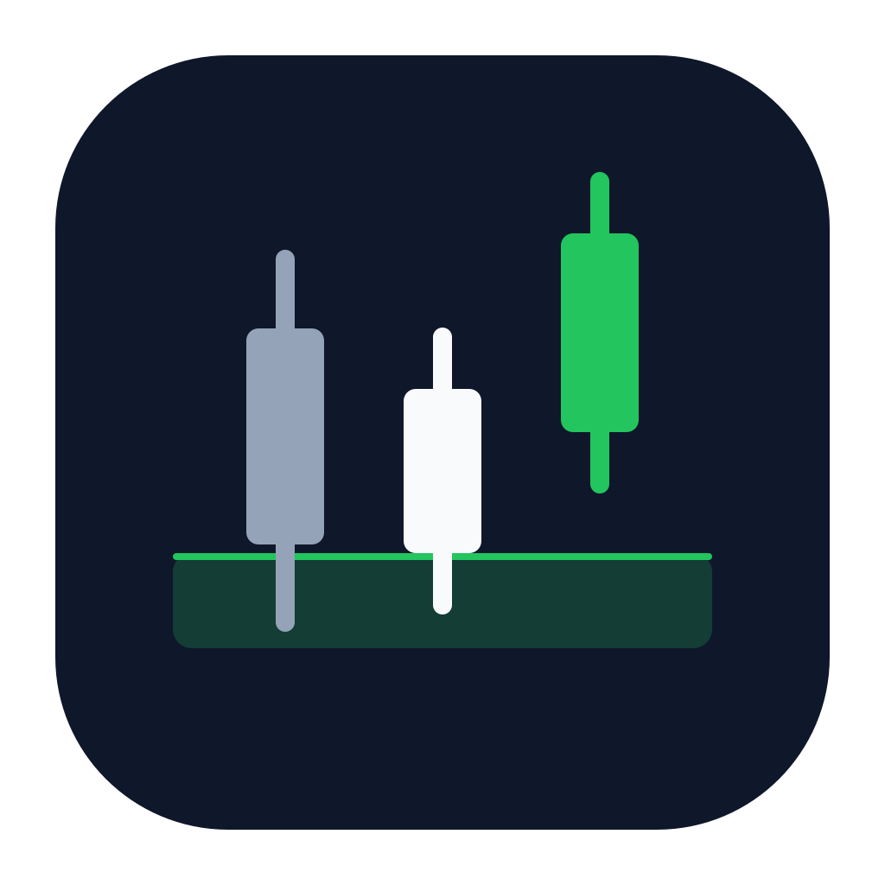

<p align="center">
  
</p>

<h1 align="center">SMC Workstation</h1>

<p align="center">
  <b>Особиста робоча станція трейдера для стратегії Smart Money Concepts.</b><br>
  Скринер · журнал угод · статистика · бектест · алерти на Mac і в Telegram
</p>

---

Локальний додаток для macOS, яким я користуюся сам: шукає на ринку ситуації за правилами моєї стратегії
(ордерблоки на 4h), веде журнал угод, рахує статистику в R і перевіряє правила на історії.

> **Статус:** робочий інструмент для власного використання, не продукт і не сервіс.

> ⚠️ **Це не фінансова порада і не торговий робот.** SMC Workstation лише читає ринкові дані й надсилає сповіщення.
> Він не відкриває угод, не має доступу до біржового рахунку і не дає рекомендацій «купуй / продавай».

## Що вміє

| Вкладка | Що там |
|---|---|
| **Скринер** | Binance USDT-M ф'ючерси (і форекс через MT5): структура 4h, зони, R:R, бали й попередження. Графіки кожного кандидата, уточнення входу на 15m, живі алерти «ЦІНА В ЗОНІ». |
| **Спот** | Спотовий ринок: «накопичення» та «новий лістинг». |
| **Журнал** | Усі угоди: зі сигналу скринера або вручну. Автоперевірка за правилами під час введення, калькулятор результату в R і MFE, резервні копії (зокрема в iCloud Drive), експорт CSV. |
| **Підсумок** | Статистика в R: вінрейт, очікування, profit factor, просадка, серії, крива накопиченого R. Розрізи й перевірка гіпотез («за правилами» проти «поза правилами» тощо). |
| **Стратегія** | Документ стратегії в Markdown з історією версій. |
| **Історія** | Журнал змін самого підходу: що змінили, навіщо і що з цього вийшло. |
| **Бектест** | Кеш свічок, пошук сигналів на історії тим самим кодом скринера, симуляція угод на 1h, метрики й розрізи. Перевірка «поза вибіркою» відкривається окремо, щоб не підганяти правила під історію. |
| **Налаштування** | Параметри скринера (видно точну команду запуску), алерти Mac (банер, поп-ап, звук, голос), Telegram, форекс (MT5), перезапуск і закриття додатка. |

### Що показав бектест

Чесно, як є: на 12 місяцях і 56 монетах поточна стратегія дає **≈ 0R на угоду** — переваги немає. На форексі (28 пар) усі варіанти збиткові.
Тому стратегію тут не підганяють під історію: її перевіряють бектестом і власним журналом.

## Швидкий старт (macOS)

Потрібно: macOS, Python 3.9+ (системний `/usr/bin/python3` підходить), бібліотека `requests`, Google Chrome (бажано).

```bash
git clone https://github.com/zbihlei/smc-workstation.git ~/smc_workstation
```

```bash
cd ~/smc_workstation && python3 app.py
```

Додаток відкриється в браузері на **http://127.0.0.1:8765**. Далі все кнопками: «Старт» запускає скринер, «Стоп» зупиняє.

**Без Терміналу.** Один раз зібрати ярлик:

```bash
cd ~/smc_workstation && python3 make_app.py
```

У `~/Applications` з'явиться **SMC Workstation.app** (Launchpad, Spotlight, можна перетягнути в Dock). Він запускає сервер у фоні й відкриває окреме вікно Chrome без вкладок.
Якщо перенесеш папку — запусти `make_app.py` ще раз. Прибрати ярлик: `python3 make_app.py --remove`.

### Необов'язкові підключення

- **Telegram** — алерти в чат. Токен бота задається змінною середовища `SMC_TG_TOKEN` у `~/.zshrc`, далі «Налаштування → Telegram → Підключити».
- **Форекс (MetaTrader 5)** — робот `mt5/SMC_Bridge.mq5` лише записує свічки 28 пар у файли, додаток їх читає. Покрокова інструкція — у «Налаштуваннях → Форекс (MT5)».
- **Google Таблиця** — старий спосіб вести журнал, за замовчуванням вимкнено. Скрипт-приймач (`apps_script/Code.gs`) містить токен і в репозиторій не входить.

**Секрети** (`SMC_TG_TOKEN`, `SMC_SHEET_URL`, `SMC_SHEET_TOKEN`) живуть лише у змінних середовища. Додаток їх не зберігає, не показує і не пише в логи.

## Де лежать дані

Усе локально, у папці додатка. У git нічого з цього не потрапляє:

| Шлях | Що там |
|---|---|
| `data/journal.db` | журнал угод (SQLite) і `backup/` з копіями |
| `data/settings.json` | налаштування (без секретів) |
| `data/strategy.md`, `data/changelog.json` | стратегія та «Історія» |
| `data/backtest/`, `data/fx_history/` | кеш свічок для бектесту |
| `results/` | результати й логи скринера: сигнали, «вибулі», зняття стопів |

Час у логах — місцевий час Mac; UTC — лише у свічках біржі й кеші бектесту.

## Як влаштовано

Python 3.9, лише стандартна бібліотека + `requests`. Фронтенд — ванільний JS без збирача, графіки — [Lightweight Charts](https://www.tradingview.com/lightweight-charts/) (лежить локально в `static/vendor`).

| Модуль | Що робить |
|---|---|
| `app.py` | HTTP-сервер (`/api/*`), налаштування, запуск/зупинка скринерів, сповіщення Mac, перезапуск |
| `smc_screener.py` | скринер Binance USDT-M: структура, зони, фільтри, R:R, бали; `--selftest` |
| `screener_runner.py` | розклад сканів, дані для графіків, логи сигналів і «вибулих», зняття стопів на 15m |
| `ltf.py` | уточнення входу на 15m і живі алерти |
| `fx_runner.py`, `fx_source.py`, `mt5/SMC_Bridge.mq5` | форекс через файли MT5 |
| `spot_scan.py` | спотові скани |
| `journal.py`, `stats.py` | журнал угод, бекапи, прив'язка сигналів; статистика й гіпотези |
| `backtest_data.py`, `backtest_signals.py`, `backtest_trades.py` | бектест: кеш свічок → сигнали → угоди й метрики |
| `tg.py` | Telegram |
| `make_app.py` | збирає `SMC Workstation.app` |
| `static/` | інтерфейс: `index.html`, `style.css`, `app.js`, `journal.js`, `summary.js`, `backtest.js` та ін. |

Нова логіка скринера завжди додається **за прапорцем, вимкненим за замовчуванням**, і вмикається лише після бектесту.

## Тести

```bash
python3 smc_screener.py --selftest
```

```bash
for t in tests/test_*.py; do python3 "$t" || echo "FAIL $t"; done
```

```bash
node tests/test_code_gs.js
```

Тести інтерфейсу працюють на Playwright (один раз: `pip3 install --user playwright && python3 -m playwright install chromium`).
Вони піднімають власні сервери з фейковими Binance, MT5 і Google на інших портах, тож запущений додаток не заважає й мережа не потрібна.

Відомі відкладені падіння (до нової версії): верстка вузького екрана (`test_ui`, `test_backtest_trades`), `test_step4` (збирач ярлика без компілятора), `test_restart` (рядок у лозі після перезапуску).

## Ліцензії

Графіки: TradingView Lightweight Charts™ — Apache 2.0, текст ліцензії в `static/vendor`.
